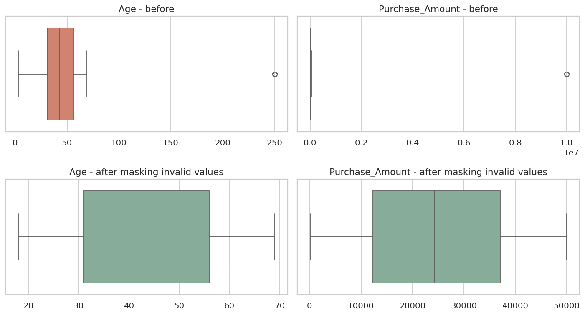
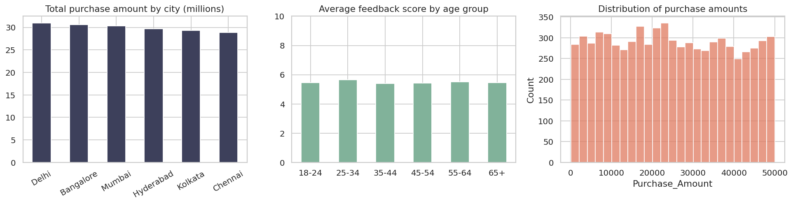

# Customer Sales Data Cleaning & Preprocessing

Turning a messy customer sales dataset of **10,200 records** into **9,000 unique, analysis-ready customers** using Python, Pandas, NumPy and SciPy, with every cleaning decision documented and validated.

## Overview

The raw data had inconsistent spellings (8 ways to write gender), ages stored as text (`"51.0 years"`), missing values in almost every column, duplicate customers, impossible values (age 250, a purchase of 9,999,999), phone numbers that lost their leading zeros, and purchase dates that fall before the signup date.

**Skills demonstrated:** data profiling, regex parsing, categorical standardization, outlier detection (statistical vs domain rules), missing-value imputation with audit flags, deduplication, data validation, light EDA.

## Results at a glance

| Metric | Before | After |
|---|---|---|
| Rows | 10,200 | 9,000 unique customers |
| Rows without Customer_ID | 1,023 | 0 |
| Exact duplicate rows | 15 | 0 |
| Repeated Customer_IDs | 177 | 0 |
| Missing cells | 7,804 | 903 (purchase dates, left blank on purpose) |
| Gender spellings | 8 | 2 (+ Unknown) |
| City variants | 18 | 6 (+ Unknown) |
| Country labels | 4 | 1 |
| Age format | Text (`"51.0 years"`) | Integer |
| Invalid ages / purchase amounts | not checked | 15 / 13 masked, then imputed |
| Phone numbers under 10 digits | 1,064 | 0 |
| Last purchase before signup | not checked | 823 flagged |

Row accounting: 10,200 → 9,177 (dropped rows with no Customer_ID) → 9,000 (merged 177 duplicate rows).

## How the data was cleaned

| Problem | Approach |
|---|---|
| Gender, City, Country written many ways | Trimmed, normalized case, mapped to one label per value |
| Titles and suffixes in names (`Mr.`, `Dr.`, `MD`, `PhD`) | Removed with regex (415 names) |
| Age stored as text | Extracted the number with regex |
| Phone numbers shortened to 6-9 digits | Padded back to 10 digits (leading zeros lost when stored as integers) |
| 1,023 rows with no Customer_ID | Dropped, since they can't be matched or de-duplicated (only 32 share an email with a known customer) |
| Invalid ages and purchase amounts | Z-score check, then domain rules (age 18-100, amount > 0 and < 100,000). Invalid values are masked, not deleted, so valid fields on the same row survive |
| Duplicate customers | Confirmed repeated IDs share the same name and email, then merged them, keeping the first non-missing value per field |
| Missing numeric values | Median, with a `*_Imputed` flag column for each |
| Missing Gender and City | `"Unknown"` category, to avoid inventing demographic data |
| Impossible dates | Last purchase before signup is **flagged**, not changed |

**Why not just use the z-score?** It caught only 11 of the 28 invalid values. A purchase of -500 or an age of 3 isn't statistically extreme, but both are impossible, so domain rules do the actual work.



## Quick EDA

With imputed values excluded via the flag columns, the data is fairly uniform: average purchase differs by about 6% across cities, and average feedback is 5.4-5.6 for every age group. No single segment stands out.



## Tech stack

Python · Pandas · NumPy · SciPy · Matplotlib · Seaborn · Jupyter Notebook

## Repository structure

```
customer-sales-data-cleaning/
├── README.md
├── requirements.txt
├── .gitignore
├── data/
│   ├── messy_customer_sales_data.csv      # raw input
│   └── clean_customer_sales_data.csv      # cleaned output (9,000 rows, 16 columns)
├── notebooks/
│   └── data_cleaning.ipynb                # full walkthrough with outputs
└── images/
    ├── outliers_before_after.png
    └── eda_summary.png
```

## How to run

```bash
git clone https://github.com/<your-username>/customer-sales-data-cleaning.git
cd customer-sales-data-cleaning
pip install -r requirements.txt
jupyter notebook notebooks/data_cleaning.ipynb
```

The notebook ends with automated checks (unique IDs, valid age and amount ranges, 10-digit phones, allowed categories) and fails loudly if any rule is broken.

## Output columns

The clean file keeps the 12 original columns and adds 4 audit columns: `Age_Imputed`, `Purchase_Amount_Imputed`, `Feedback_Score_Imputed` (True where the value was filled in) and `Last_Purchase_Before_Signup`.

## Limitations

- Median imputation keeps the center of each distribution but shrinks its spread. Use the `*_Imputed` flags to exclude filled values when it matters.
- 903 customers have no last-purchase date, and 823 have a last purchase before signup. Neither can be fixed without a second source.
- Phone padding assumes the lost digits were leading zeros. That fits the pattern in the data but can't be proven.
- Dropping the 1,023 rows with no Customer_ID removes about 10% of the raw records.
- The data looks synthetic (all emails use `example.com/org/net`), so the EDA shows the method rather than real business findings.

## Author

**Udit Narayan** · [LinkedIn](https://www.linkedin.com/in/udit-narayan-7902aa293/)
